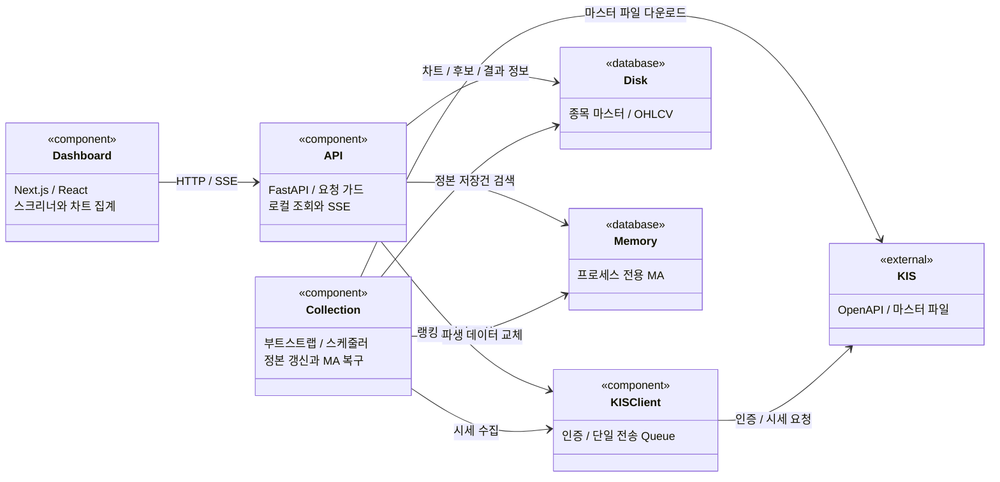
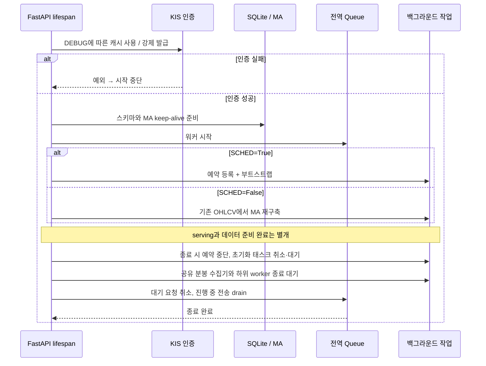

# Overview

- 1 OCPU·1GB RAM에서 데이터 정합성과 운영 안전성을 우선한다. [판단 기준](../AGENTS.md)
- 외부 API 지연과 호출 예산의 영향을 줄이기 위해 로컬 SQLite를 조회 기준으로 삼는다.

# Checkpoints

- Queue·스케줄러·MA 상태는 프로세스 단위로 공유하므로 worker 증설 시 호출 제한과 수집 소유권을 재검토한다. [실행 구성](../Dockerfile)
- 별도 DB 서버와 분산 큐를 두지 않아 운영 비용을 줄이며, 단일 프로세스 장애가 수집과 조회 모두에 영향을 준다. [앱 수명주기](../app/main.py)
- OHLCV는 디스크 정본으로, MA는 재계산 가능한 파생 데이터로 관리해 장애 복구 시 재수집을 줄인다. [저장 계약](database.md)
- 전체 OHLCV의 메모리 복제를 피하고 MA만 사전 계산해 메모리 사용량과 조회 비용을 절충한다. [측정 근거](benchmark.md#저장-계층-분리-기록)
- `/health`는 프로세스 응답만 확인하며 데이터 최신성·수집 완료·인증 유효성을 보장하지 않는다. [상태 경계](../app/main.py)
- 시스템 가드는 새 API 요청을 거부하는 중첩 카운터이며 작업 간 잠금이나 진행 중 요청의 취소 수단이 아니다. [가드 구현](../app/core/state.py)
- MA 준비 상태는 스크리너만 제한하고, 예약 마스터 갱신·GC·정규 일봉 작업의 전체 API 가드와 구분한다. [요청 가드](../app/core/dependencies.py)
- 인증·DB·외부 조회 실패를 빈 데이터로 바꾸지 않아 재수집과 검색 결과의 오판을 막는다. [검증 계약](testing.md)
- 배포는 격리 테스트 통과 후 진행하며, Compose 재시작에 따른 중단과 수동 복구 비용을 감수한다. [배포 구성](../.github/workflows/deploy.yml)

# Diagrams

## 컴포넌트 의존 관계 - 클래스 다이어그램

## 앱 수명주기 - 시퀀스 다이어그램

# Tests

[Stage 5](../tests/test_stage5.py)는 최초 인증 실패의 serving 차단, Queue 시작 이후 실패 정리, MA 준비 실패 시 스크리너만 거부하는 경계, 분봉 수집기 종료 순서를 검증한다. [Stage 3](../tests/test_stage3.py)은 전송 직렬화와 종료·재시작을 검증한다.

이 검증은 격리된 입력과 자원에 대한 계약 검증이다. 실제 KIS와 예약 작업의 장시간 공존, 운영 저장장치 장애, 브라우저 전체 흐름의 보장은 [미검증 범위](testing.md#검증의-한계)에 남겨 둔다.
