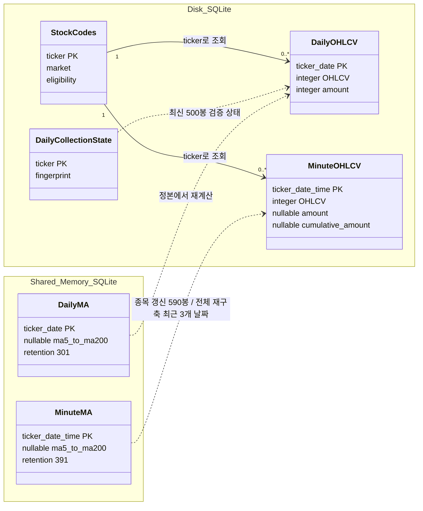
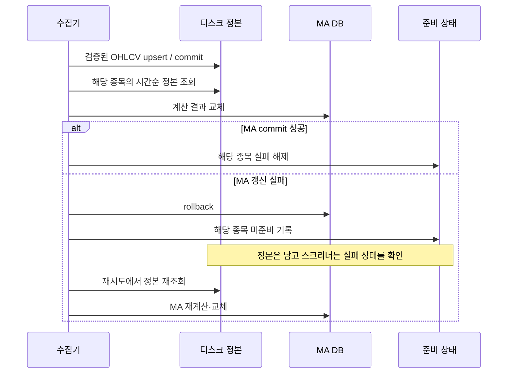

# Overview

- 디스크 SQLite에 정본을, Shared In-Memory SQLite에 MA를 두어 데이터 중복과 반복 계산을 줄인다.
- MA 소실은 보존된 OHLCV에서 복구해 외부 재수집 비용을 피한다.

# Checkpoints

- 전 종목 검색은 사전 계산 MA를, 단일 종목 차트는 디스크 SQL 윈도를 사용해 조회 규모에 맞게 계산 비용을 배분한다. [측정 근거](benchmark.md#저장-계층-분리-기록)
- MA 기간 부족은 `NULL`로 두어 준비되지 않은 값을 유효한 지표로 취급하지 않는다. [계산 계약](../app/core/ma_calculator.py)
- 일봉 MA 301행·분봉 MA 391행은 최대 300봉·390봉 조건과 직전 교차 비교를 위한 보존량이다. [검색 계약](screener.md)
- 종목별 분봉 갱신은 `391 + 200 - 1 = 590`개 원본으로 첫 보존 행의 MA200까지 예열한다. [종목별 재계산](../app/tasks/minute_ohlcv_scheduler.py)
- 전체 분봉 재구축은 DB 전체의 최신 3개 날짜를 사용하므로 거래가 드문 종목의 590봉 확보를 보장하지 않는다. [전체 재구축](../app/core/bootstrap.py)
- 디스크와 MA는 별도 commit이며, 정본 저장 후 MA 실패는 해당 종목을 미준비로 남겨 재시도한다. [실패 상태](../app/core/state.py)
- 재수집 후 MA는 정본에서 다시 계산해 중복 입력에 따른 지표 변화를 막는다. [멱등성 검증](../tests/test_stage2.py)
- 전체 재구축은 디스크 snapshot과 두 MA 테이블의 교체 트랜잭션을 사용하며, 트랜잭션 내부 오류는 함께 롤백한다. [재구축 구현](../app/core/bootstrap.py)
- 재구축 호출자 취소는 스레드 종료를 기다린 뒤 미준비로 표시하며, 대기 중 MA commit이 끝날 수 있다. [취소 경계](../app/core/bootstrap.py)
- 재구축 시작 이후 생긴 종목 실패는 실패 세대로 구별해 과거 snapshot의 성공으로 지우지 않는다. [복구 검증](../tests/test_stage5.py)
- 분봉 대금의 차분 근거가 없으면 `NULL`로 두고, 원본 누적값을 보존해 재수집 시 교정한다. [수집 계약](scheduler.md)
- `STRICT`와 복합 키로 타입과 캔들 식별을 검사하며, 종목 마스터와의 관계는 외래 키로 강제하지 않는다. [스키마](../app/core/database.py)
- MA keep-alive는 프로세스가 소유하고 일반 연결은 `finally`에서 닫아 메모리 DB 소실과 연결 누수를 막는다. [연결 수명](../app/core/database.py)
- 디스크 연결의 `uri=True`와 ATTACH 값 바인딩으로 플랫폼별 URI 해석 차이를 제거한다. [재현 근거](testing.md#과거-검증-기록)
- WAL·`synchronous=NORMAL`은 읽기 공존과 쓰기 비용을 절충하며 전원 장애 시 최근 commit의 내구성을 보장하지 않는다. [SQLite 계약](https://www.sqlite.org/pragma.html#pragma_synchronous)
- 운영 동기화는 PASSIVE 체크포인트이며, 정상 반환이 WAL 완전 반영을 뜻하지 않는다. 명시적 메모리 backup은 테스트 경로다. [구현](../app/core/database.py), [SQLite 계약](https://www.sqlite.org/pragma.html#pragma_wal_checkpoint)

# Diagrams

## 데이터 소유권과 파생 관계 - 클래스 다이어그램

## 종목 단위 저장과 복구 - 시퀀스 다이어그램

# Tests

- [Stage 1](../tests/test_stage1.py): 모든 MA 창의 독립 분수 계산, 기간 부족, STRICT·PK·rollback, 디스크/MA/스레드 격리와 연결 수명.
- [Stage 2](../tests/test_stage2.py): 재수집 전후 전체 OHLCV와 보존 MA의 일치, NULL 대금의 보존·교정.
- [Stage 5](../tests/test_stage5.py): commit 전후 프로세스 종료, MA 소실 후 복구, MA 교체 실패와 재시도, WAL reader와 쓰기 잠금.

검증 환경과 실행 명령은 [정합성 테스트](testing.md)에 둔다. 위 테스트의 성공을 두 저장소의 전역 원자성이나 저장장치 장애 검증으로 확대하지 않는다.
