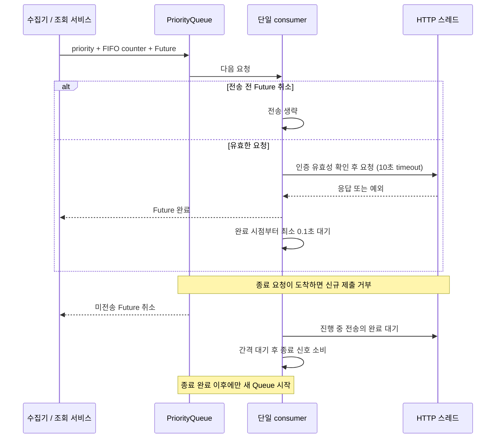
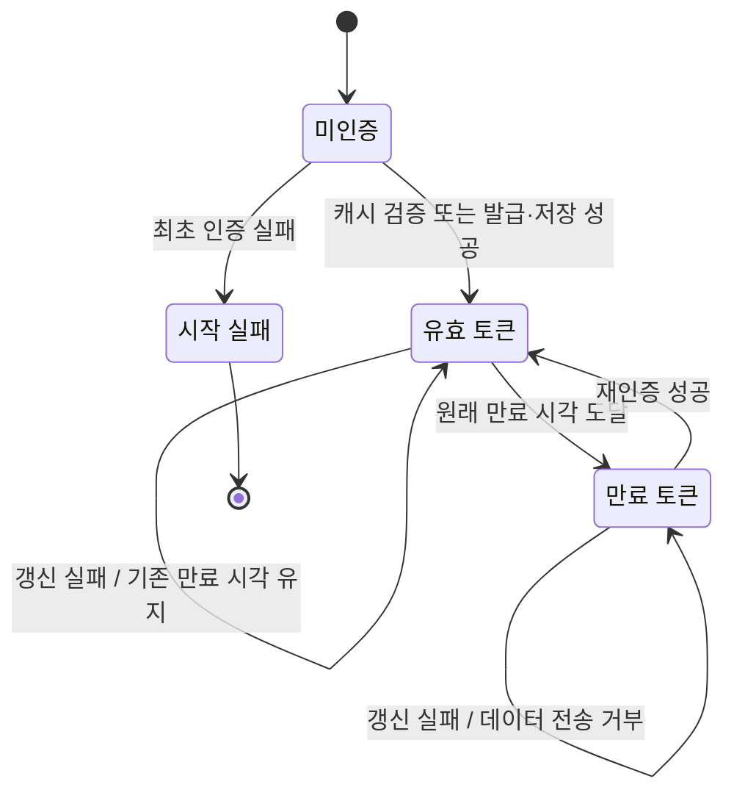

# Overview

- 외부 지연·호출 제한·인증 실패가 로컬 데이터의 의미를 바꾸지 않도록 연동 경계를 둔다.
- PROD 단일 모드를 유지하고 KIS Code Assistant MCP로 확인한 공식 예제를 요청 계약의 근거로 삼는다.

# Checkpoints

- 시세·랭킹 요청은 단일 PriorityQueue consumer로 전송해 여러 작업의 합산 호출량을 제한한다. [전송 경계](../app/core/kis_fetch.py)
- 낮은 우선순위 숫자와 동일 우선순위 FIFO를 따르며, 진행 중 요청의 선점이나 우선순위 간 공정성은 보장하지 않는다. [Queue 검증](../tests/test_stage3.py)
- 전송 완료 후 최소 0.1초를 기다리며, 이는 프로젝트의 운영 간격으로 KIS 전체 상품의 공식 상한을 뜻하지 않는다. [간격 검증](../tests/test_stage3.py)
- 일반 HTTP 10초·인증 30초 타임아웃을 유지해 실패한 요청의 대기를 제한한다. [데이터 요청](../app/core/kis_fetch.py), [인증](../app/core/kis_auth.py)
- 종료 시 미전송 요청을 취소하고 진행 중 HTTP와 간격 대기를 마친 뒤 재시작해 전송기 중첩을 막는다. [종료 계약](../app/core/kis_fetch.py)
- 호출자 취소로 이미 시작한 HTTP를 중단할 수 없으므로 공유 종료 작업은 호출자 취소와 독립적으로 유지한다. [취소 검증](../tests/test_stage3.py)
- 재시도는 수집기 예산에 맡겨 Queue와 상위 작업의 재시도가 중복되지 않게 한다. [수집 예산](scheduler.md)
- 최초 인증은 DB·Queue 생성 전에 확정하며, 잘못된 토큰·만료 시각·캐시 저장 실패는 시작 실패로 전달한다. [인증 경계](../app/core/kis_auth.py)
- `DEBUG`는 캐시 재사용·강제 발급만 제어하므로 `SCHED=False`에서도 인증을 수행한다. [시작 정책](../app/main.py)
- 예약 갱신은 `force=False`를 사용하며, 실패 시 기존 환경과 원래 만료 시각을 유지하고 만료 후 전송을 거부한다. [갱신 검증](../tests/test_stage3.py)
- 인증 오류의 원문과 비밀값은 노출하지 않고 데이터 요청의 인증 헤더는 마스킹한다. [인증 구현](../app/core/kis_auth.py), [전송 로그](../app/core/kis_fetch.py)
- 토큰 요청은 PROD `/oauth2/tokenP`와 `client_credentials` 계약을 따른다. [공식 예제](https://github.com/koreainvestment/open-trading-api/blob/main/examples_llm/auth/auth_token/auth_token.py)
- 일봉 요청은 `FHKST03010100`과 1회 최대 100건을 기준으로 수집 범위를 잡는다. [공식 예제](https://github.com/koreainvestment/open-trading-api/blob/main/examples_llm/domestic_stock/inquire_daily_itemchartprice/inquire_daily_itemchartprice.py)
- 분봉 요청은 `FHKST03010230`과 1회 최대 120건의 날짜·시각 조회 계약을 따른다. [공식 예제](https://github.com/koreainvestment/open-trading-api/blob/main/examples_llm/domestic_stock/inquire_time_dailychartprice/inquire_time_dailychartprice.py)
- HTTP 200과 `rt_cd == "0"`을 함께 확인하고, output 구조·숫자·시각은 수집기와 서비스에서 검증한다. [응답 경계](../app/core/kis_fetch.py)
- OAuth와 마스터 파일 다운로드는 시세 Queue 밖의 경로다. [마스터 연동](../app/tasks/init_stock_codes.py)
- 공식 예제의 모의투자 분기·오류 반환 방식을 그대로 이식하지 않고 프로젝트의 운영·실패 계약을 유지한다. [프로젝트 경계](../AGENTS.md)

# Diagrams

## 요청 처리와 종료 - 시퀀스 다이어그램

## 인증 상태 전이 - 상태 다이어그램

# Tests

[Stage 3](../tests/test_stage3.py)은 실제 Queue와 간격 대기를 실행해 FIFO·우선순위·직렬화, timeout 이후 사용 가능성, 미전송 취소, 전송 중 종료·재시작을 검증한다. 인증은 임시 캐시와 합성 HTTP를 사용해 발급 실패·만료·비밀값 노출 방지·갱신 실패 후 상태를 확인한다. [Stage 5](../tests/test_stage5.py)는 인증 실패가 DB·Queue 생성과 serving을 막는지 확인한다.

실제 KIS 선택 검증은 [별도 명령](testing.md#실제-kis-선택-검증)으로 분리한다. 일반 테스트는 실제 토큰 정책이나 장시간 호출 제한의 보증이 아니다.
