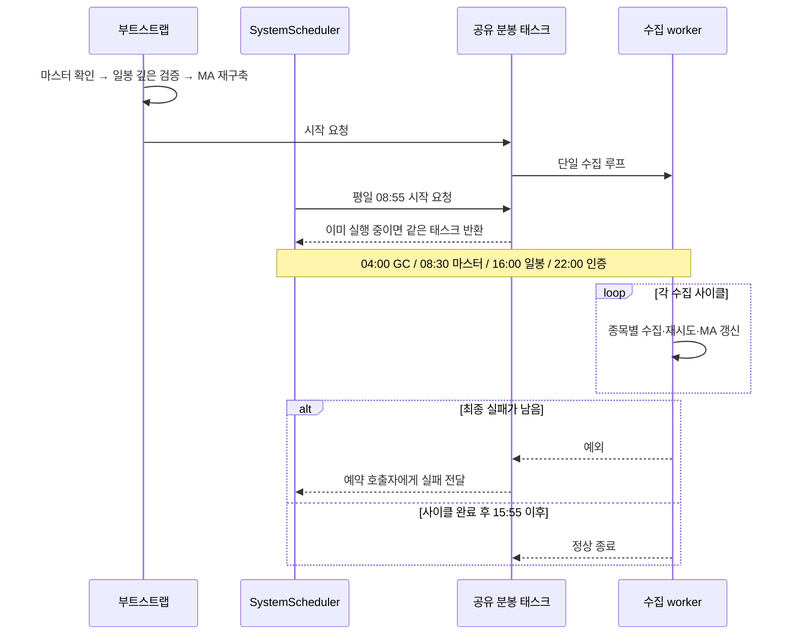
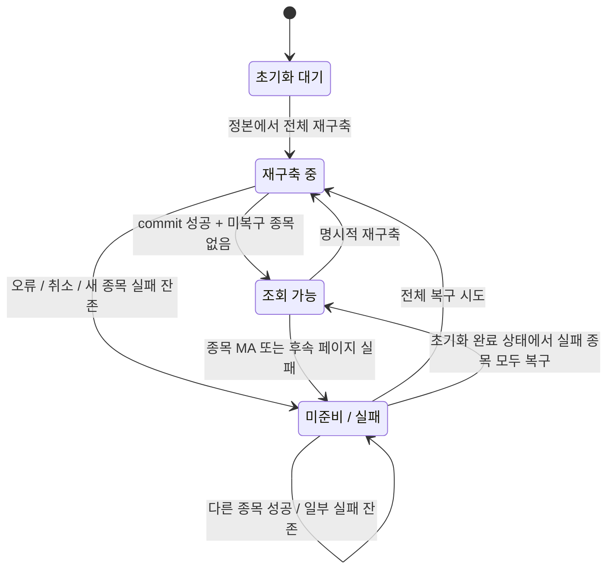

# Overview

- 예약·부트스트랩·재시도가 같은 정본과 호출 예산을 사용하므로 작업 소유권과 완료 기준을 공유한다.
- 부분 저장과 취소를 정상 완료로 처리하지 않아 재실행으로 데이터를 복구할 수 있게 한다.

# Checkpoints

- 부트스트랩과 예약은 같은 분봉 태스크를 공유해 시작 경로가 달라도 수집기가 중복되지 않게 한다. [소유권 검증](../tests/test_stage5.py)
- 종료는 초기화·분봉 수집기·하위 worker를 정리한 뒤 KIS Queue를 닫아 취소 이후 요청 생성을 막는다. [앱 종료](../app/main.py)
- 예약은 `Asia/Seoul`, `max_instances=1`, `coalesce=True`를 사용하며 실패한 분봉 루프를 자동 재시작하지 않는다. [예약 정책](../app/core/scheduler.py)
- 일봉 증분은 최신 500봉 fingerprint가 일치할 때만 조기 종료해 최신 날짜만으로 내부 갭을 놓치지 않게 한다. [수집 근거](../app/tasks/daily_ohlcv_scheduler.py)
- 최초·미검증·로컬 변경·부트스트랩은 깊은 검증을 수행하며, 500봉 미만의 이력은 빠른 증분 경로로 승격하지 않는다. [검증 사례](../tests/test_stage2.py)
- 일봉 검증 예산이 부족하거나 수집 중 로컬 fingerprint가 바뀌면 이번 결과를 저장하지 않는다. [저장 경계](../app/tasks/daily_ohlcv_scheduler.py)
- 확인한 일봉 응답 범위의 불필요한 로컬 행은 제거하되, 페이지 밖 원본 정정은 다음 깊은 검증까지 지연될 수 있다. [복구 범위](../app/tasks/daily_ohlcv_scheduler.py)
- 분봉은 시간순 정규화와 상충 중복 검증 후 누적 차분을 계산하며, watermark와 같은 시각의 수정도 반영한다. [변환 계약](../app/tasks/minute_ohlcv_scheduler.py)
- 부분 재수집의 대금은 OHLCV와 누적값이 모순 없을 때만 보존하고, 차분 근거가 없으면 `NULL`로 둔다. [정합성 검증](../tests/test_stage2.py)
- 페이지 밖 후속 대금은 정확히 다음 분이고 두 누적값이 있을 때만 보정해 떨어진 봉을 인접 원본으로 추정하지 않는다. [보정 경계](../app/tasks/minute_ohlcv_scheduler.py)
- 분봉 watermark는 OHLCV·MA 성공 후 전진하며, 저장 후 페이지·MA 실패는 미준비 상태로 남겨 재시도한다. [복구 계약](database.md)
- 종목 처리당 일봉 최대 5요청·분봉 정규 worker 최대 15단계를 사용하고, 재시도는 각각 최대 5회·3회와 0.5초 재등록 대기를 유지한다. [일봉](../app/tasks/daily_ohlcv_scheduler.py), [분봉](../app/tasks/minute_ohlcv_scheduler.py)
- 초기 DB 조회 오류는 전송 전에 중단하고, 재시도 후 종목 실패가 남으면 전체 작업도 실패로 전달한다. [실패 검증](../tests/test_stage5.py)
- 2,400종목의 5요청·1요청 수집 간격 합계는 1,200초·240초이며, HTTP·DB·재시도를 제외한 산술값이다. [호출량 측정](benchmark.md#일봉-수집-비교)
- GC는 종목별 일봉 500개·분봉 2개 저장 거래일을 보존하며, 전날 일봉 부재를 실제 휴장이나 수집 완전성의 증거로 보지 않는다. [GC 구현](../app/core/scheduler.py)
- 예약 마스터·GC·정규 일봉 작업은 전체 API 가드와 체크포인트를 사용하고, MA 재구축은 별도 준비 상태로 관리한다. [가드 경계](architecture.md#checkpoints)

# Diagrams

## 시작 경로와 공유 수집기 - 시퀀스 다이어그램

## MA 준비 상태 - 상태 다이어그램

# Tests

[Stage 2](../tests/test_stage2.py)는 최초·증분·중복·과거 갭·부분 재수집을 독립 원본과 비교한다. [Stage 5](../tests/test_stage5.py)는 MA 실패 후 watermark 재시도, 재구축 중 새 실패 보존, 공유 분봉 태스크, 취소 후 하위 worker 종료, DB 조회 오류 전파와 GC 보존 범위를 확인한다.

실제 거래일 달력, 페이지 밖 수정주가, 장시간 인증·예약·수집 공존은 별도 검증 영역이다. 합성 테스트와 호출량 산술만으로 운영 완료 시각을 보장하지 않는다.
