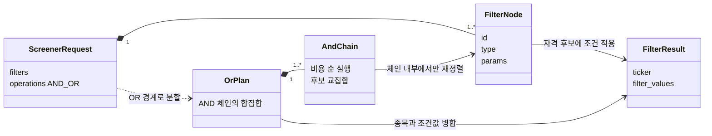
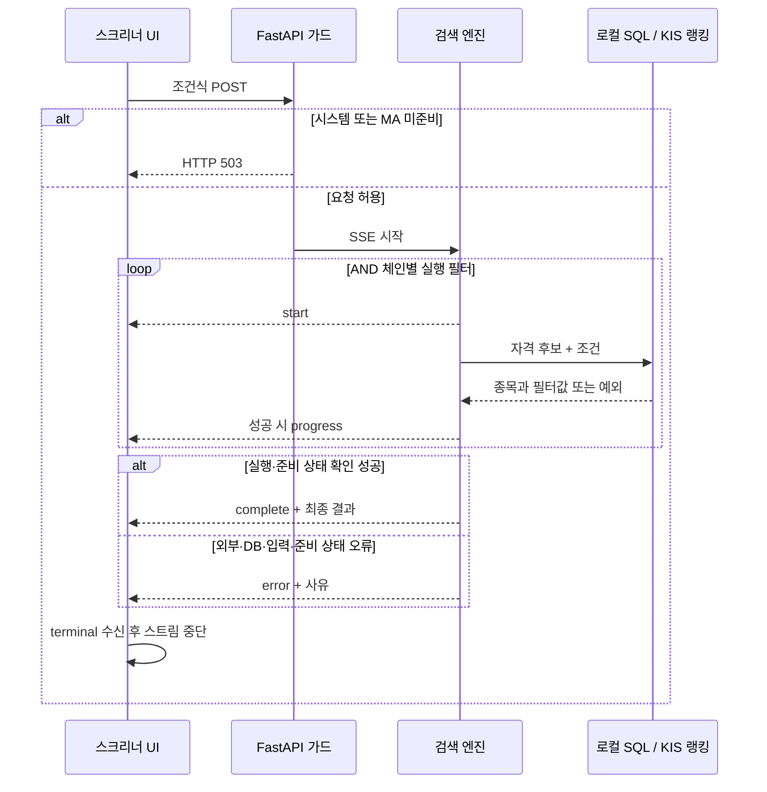

# Overview

- 조건식의 실행 순서가 달라져도 같은 종목과 필터값을 반환한다.
- 후보 축소와 MA 사전 계산으로 비용을 줄이며 필터 논리와 실패 의미를 유지한다.

# Checkpoints

- AND를 OR보다 먼저 결합하고 AND 체인 내부에서만 재정렬해 조건식의 의미를 보존한다. [논리 검증](../tests/test_stage4.py)
- 모든 필터에 거래정지·관리종목 제외를 적용하고, 제외 후에도 원본 랭킹 순번을 유지한다. [자격 검증](../tests/test_stage4.py)
- 앞선 후보만 다음 SQL에 전달하고 빈 교집합의 후속 실행을 생략해 불필요한 조회를 줄인다. [실행 계획](../app/services/screener_service.py)
- 비용 정렬은 고정 추정이므로 최적 순서를 보장하지 않으며, 성능 비교 전에 결과 동등성을 확인한다. [측정 근거](benchmark.md#과거-http-측정-기록)
- MA 조건은 시간축 혼합·기간 중복을 금지하고 일봉 300봉·분봉 390봉 한도를 보존량과 함께 유지한다. [저장 계약](database.md#checkpoints)
- 기간 부족의 `NULL`은 해당 조건의 계산 불가이며 시스템 초기화 실패와 구별한다. [필터 판정](../app/services/screener_service.py)
- 이격도는 유효한 MA가 존재하는 최신 공통 timestamp의 `현재가 / MA × 100`으로 계산한다. [이격도 검증](../tests/test_stage4.py)
- 거래량 돌파는 현재 봉을 제외한 최대 거래량 봉의 고가와 비교하며, 동률이면 최신 봉을 택한다. [산술 검증](../tests/test_stage4.py)
- `1M/3M/2H/4H`는 30/60/120/240개 캔들이며 실제 달력 월이나 경과시간을 보장하지 않는다. [기간 매핑](../app/services/screener_service.py)
- 결과 거래대금은 최근 저장 분봉의 원본 누적값과 KST 기준 시각을 제공하며, 원본이 없으면 `NULL`이다. [결과 계약](../app/schemas/screener.py)
- SSE는 진행 상태를 전달하고 `complete/error`로 종료하며, 외부 실패를 정상 0건이나 부분 성공으로 바꾸지 않는다. [스트림 검증](../tests/test_stage4.py)
- MA 미준비는 새 요청에서 503, 진행 중 스트림에서 오류로 전달하며 요청 전체의 동일 DB snapshot은 보장하지 않는다. [가드](../app/core/dependencies.py), [검색 엔진](../app/services/screener_service.py)
- 생략한 후속 필터에는 `start` 없이 0건 `progress`를 보낼 수 있으며, 오류가 발생하면 반복을 중단한다. [SSE 구현](../app/services/screener_service.py)
- 주·월 차트는 KST 거래일로 묶고 마지막 유효 원본 MA를 표시하므로 일봉 MA5가 5주 MA로 바뀌지 않는다. [차트 집계](../web/lib/chart-utils.ts)
- SQL 식별자는 화이트리스트를 사용하고 임계값·종목은 바인딩하나, 기간 일부의 검증 후 문자열 삽입은 AGENTS 원칙과 남아 있는 차이다. [현재 구현](../app/services/screener_service.py), [원칙](../AGENTS.md)
- 조건 추가 시 UI·서버·독립 기대값의 단위를 맞추고, 브라우저 종료·취소·재연결은 서버 SSE 검증과 별도로 확인한다. [UI](../web/components/screener/ScreenerBuilder.tsx), [검증 한계](testing.md#검증의-한계)

# Diagrams

## 조건식과 실행 계획 - 클래스 다이어그램

## 검색 요청과 결과 전달 - 시퀀스 다이어그램

# Tests

[Stage 4](../tests/test_stage4.py)는 SQL 결과를 독립 Python 산술·집합 결과와 비교한다. MA 조건·이격도·거래량 돌파, AND/OR 조합, 랭킹 우선 실행의 자격 보존, 비정상 랭킹과 정상 0건, 단일 terminal 이벤트, 전체 차트 OHLCV·MA·timestamp를 확인한다.

[차트 유틸 테스트](../web/lib/chart-utils.test.mjs)는 MA 예열 중 그룹 시작 시각과 서울·LA·UTC·키리티마티의 동일 집계를 확인한다. 이는 실제 브라우저 렌더링 검증을 대신하지 않는다. 성능 근거는 [Benchmark](benchmark.md), 실행 방법은 [정합성 테스트](testing.md)에 둔다.
