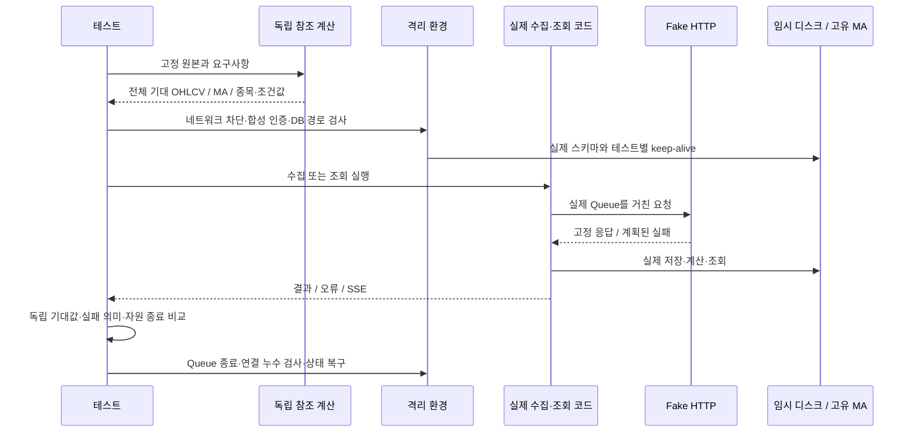

# Overview

- 수집 원본에서 저장·계산·조회까지 데이터의 의미가 유지되는지 검증한다.
- 구현과 독립적인 기대값과 재현 가능한 실패 경계를 사용한다. [검증 원칙](../AGENTS.md)

# Checkpoints

- OHLCV는 고정 원본, MA는 `Fraction`, 스크리너는 산술·집합 연산으로 기대값을 도출한다. [참조 계산](../tests/data.py)
- 기간 부족·저장 MA 반올림·차트의 반올림 없는 평균을 각각의 계약으로 비교한다. [계산 검증](../tests/test_stage1.py), [차트 검증](../tests/test_stage4.py)
- 일부 값이나 개수만 확인하지 않고 전체 OHLCV·보존 MA·차트 시각을 비교해 내부 누락과 시간축 오류를 검출한다. [수집 검증](../tests/test_stage2.py)
- 테스트 수집 전에 합성 인증·임시 캐시·외부 네트워크 차단을 적용해 운영 자격 증명 사용을 막는다. [격리 환경](../tests/support.py)
- 디스크 경로·고유 MA URI·keep-alive·cwd를 함께 분리하고 연결·ATTACH 대상을 검사해 운영 DB 접근을 차단한다. [DB 격리](../tests/support.py)
- 종료 시 Queue·연결을 정리하고 전역 상태를 복구하며, 전역 패치와 cwd를 공유하는 동일 프로세스 병렬 실행은 지원하지 않는다. [수명주기](../tests/conftest.py)
- HTTP 전송만 Fake로 대체하고 실제 Queue·변환·SQLite·MA·라우터를 실행해 모듈 사이 계약을 검증한다. [전송 경계](../tests/transport.py)
- 요청 URL·TR·종목·기간·플래그·timeout·전송 예산을 확인해 잘못된 요청으로 얻은 정상 결과를 걸러낸다. [수집·전송 검증](../tests/test_stage2.py)
- SQLite 오류·잠금·전송 지연·commit 전후 종료를 주입하고 재시도·복구·잔여 자원까지 확인한다. [장애 검증](../tests/test_stage5.py)
- 실패 시 요구사항과 독립 기준을 재검토하며 skip·xfail·허용오차 완화로 통과시키지 않는다. [검증 원칙](../AGENTS.md)
- 과거 통과는 당시 소스·환경에 한정하며, 테스트 집합이 다른 실행의 건수·시간을 품질이나 성능의 직접 비교로 쓰지 않는다. [과거 기록](#과거-검증-기록)

# Diagrams

## 독립 기준과 실제 경로 비교 - 시퀀스 다이어그램



# Tests

## 계약별 검증 지도

| 검증 경계 | 독립 판단 또는 실제 실패 기준 | 테스트 |
|---|---|---|
| 계산·저장 기반 | 모든 MA 창, 기간 부족, 식별자 화이트리스트, STRICT·PK·rollback, 격리 | [Stage 1](../tests/test_stage1.py) |
| 수집 정합성 | 최초·증분·반복·수정·내부 갭, 시간순 정규화, 누적 대금, 전체 OHLCV·MA | [Stage 2](../tests/test_stage2.py) |
| 전송·인증 | FIFO·우선순위·완료 후 간격, 취소·재시작, 캐시·발급·갱신 실패 | [Stage 3](../tests/test_stage3.py) |
| 검색·차트 | 산술·집합 참조, 자격 보존, SSE 종료 의미, 차트 전체 값·시각 | [Stage 4](../tests/test_stage4.py) |
| 복구·수명주기 | commit 전후 중단, WAL snapshot, 잠금·MA 실패, 준비 상태, 수집 소유권·취소·GC | [Stage 5](../tests/test_stage5.py) |
| 클라이언트 집계 | KST 주·월 경계, MA 예열, 캔들과 선의 동일 timestamp | [Node 차트 테스트](../web/lib/chart-utils.test.mjs) |

Stage는 검사 경계의 분류이며 앞 Stage 통과가 다음 Stage 실행의 전제는 아니다.

## 로컬 실행

환경 설치는 [README](../README.md)를 따른다. 필요한 Stage 또는 실패 사례부터 실행한다.

```powershell
uv run --locked pytest -m stage2
uv run --locked pytest -m stage3 -k restart_does_not_overlap
uv run --locked pytest --collect-only -q
uv run --locked pytest --durations=10 --tb=short
```

설치된 환경에서는 `.venv/Scripts/python.exe -m pytest`도 사용할 수 있다. 결과는 콘솔에 출력하고, 필요할 때만 pytest의 `--junitxml`로 별도 저장한다. `Harness peak RSS`는 해당 Python 프로세스의 누적 최고치이며 crash 자식 프로세스와 OS page cache를 포함하지 않는다.

차트 집계와 TypeScript 검사는 `web/`에서 실행한다.

```powershell
npm run test:chart
npx tsc --noEmit
```

## Docker Linux 검증

[Dockerfile.test](../Dockerfile.test)와 [전용 ignore](../Dockerfile.test.dockerignore)는 코드·합성 입력을 복사하고 운영 자격 증명·DB·볼륨을 사용하지 않는다. 이미지 빌드의 의존성 다운로드와 네트워크가 차단된 테스트 실행은 별개다.

```powershell
docker build -f Dockerfile.test -t trading-test:docs .
docker run --rm --cpus=1 --memory=1g --network=none --read-only --tmpfs /tmp:rw,size=512m trading-test:docs python -m pytest -q --tb=short -p no:cacheprovider
docker run --rm --network=none --read-only --tmpfs /tmp:rw,size=32m trading-test:docs python scripts/sqlite_probe.py
```

현재 [배포 CI](../.github/workflows/deploy.yml)는 격리 Linux 백엔드 테스트와 Node 차트 테스트를 이미지 빌드·배포 앞에 둔다. Ruff·TypeScript·ESLint·프론트엔드 build·배포 후 health 검사가 모두 CI 게이트에 연결된 것은 아니다. 자원 제한 벤치마크 명령은 [Benchmark](benchmark.md#재현-명령)에 둔다.

## 실제 KIS 선택 검증

`tests.live_kis`는 기본 pytest 수집에서 제외한다. 명시적으로 실제 호출을 승인한 경우에만 실행한다.

```powershell
uv run --locked python -m tests.live_kis --allow-live --ticker 005930
```

`--allow-live` 없이는 KIS 설정 import 전에 거부한다. [구현](../tests/live_kis.py)은 최근 7일·1종목에 대해 인증 발급 최대 1회와 Queue 데이터 요청 1회를 허용한다. DB 쓰기·주문·계좌 조회·재시도는 없지만 토큰 캐시는 갱신될 수 있다. 비어 있지 않은 응답과 필수 필드의 정수 변환을 확인하는 스키마 probe이며, 가격·거래량의 진실성을 독립적으로 증명하는 검사가 아니다.

## 과거 검증 기록

아래는 2026-11-13에 남긴 기존 실행 기록이다. 이번 문서 재작성에서 전체 테스트와 성능 측정을 다시 실행한 결과가 아니다. 상세 Stage별 집계·최초 실패·수정 전 기대값과 환경은 [당시 테스트 기록](https://github.com/tomatoM4to/Trading/blob/371984acb689fea1cc45952642274059146f0b0c/docs/testing.md), [당시 결함 기록](https://github.com/tomatoM4to/Trading/blob/371984acb689fea1cc45952642274059146f0b0c/docs/test-defects.md)에 보존한다.

공통 Python은 3.12.12다. Windows SQLite는 3.50.4, 제한 Linux는 Docker Desktop WSL2의 SQLite 3.40.1이며 `--cpus=1 --memory=1g --network=none --read-only`, 테스트 tmpfs 512MiB 조건이었다.

| 당시 단계 | 환경 | 통과 / 실행 | 시간 | Python peak RSS | 해석 |
|---|---|---:|---:|---:|---|
| 최초 pytest 하네스 | Windows | 56 / 75 | 11.10초 | 119.3MiB | 19개 실패로 기존 결함 재현 |
| 3단계 수정 후 | Windows | 98 / 102 | 24.81초 | 118.6MiB | ATTACH 관련 4개 실패 유지 |
| 잔여 결함 수정 전 `6c6b4d5` | Windows | 97 / 102 | 31.10초 | 117.5MiB | ATTACH 4개·간격 1개 실패 |
| 같은 수정 전 기준 | Linux | 102 / 102 | 20.39초 | 122.7MiB | SQLite URI 기본 설정 차이 |
| 잔여 결함 수정 후 | Windows | 126 / 126 | 37.62초 | 117.8MiB | 실패·오류·스킵 0 |
| 같은 수정 후 기준 | Linux | 126 / 126 | 25.80초 | 123.5MiB | 실패·오류·스킵 0 |
| 인증·DB 실패 전파 수정 후 | Windows | 154 / 154 | 46.45초 | 118.3MiB | 실패·오류·스킵 0 |
| 같은 인증·DB 수정 후 기준 | Linux | 154 / 154 | 30.12초 | 123.7MiB | 실패·오류·스킵 0 |

154개 기록의 Stage별 건수는 10/33/19/52/40이다. 이후 분봉 소유권 수정(`81f31f5`)에 [회귀 테스트](../tests/test_stage5.py)가 추가됐으므로 154개를 현재 전체 테스트 수로 사용하지 않는다. 당시 AnyIO·TestClient 경고 2개는 숨기지 않았고, 인증·DB 수정 후 Ruff check/format도 통과한 것으로 기록돼 있다.

Windows의 짧은 timer 대기와 URI ATTACH 차이는 허용 기준을 낮추는 대신 deadline 대기·명시적 URI 연결로 수정했다. Node 22.20.0의 차트 3개와 TypeScript 검사도 잔여 결함 기록에 포함된다. 문서 재작성 직전 준비 단계에서는 Stage 1 10개와 차트 3개만 재실행해 통과했고 AnyIO 경고 1개가 있었다. 이 부분 실행을 현재 전체 통과로 확대하지 않는다.

## 검증의 한계

| 남은 경계 | 현재 증거로 보장하지 못하는 것 |
|---|---|
| 실제 KIS 원본 | 수정주가·누적값의 실제 특성, 응답 완전성, 토큰 갱신 후 이전 토큰의 증권사 측 유효성 |
| 장시간 운영 | 예약·인증·수집의 장시간 공존, 메모리 누적, 전체 heavy 필터 조합의 응답성 |
| 종목 마스터 | 실제 다운로드와 CSV→종목 변환 전체 경로. 기본 하네스에서 고정 출력·외부 다운로드를 실행하지 않음 |
| 물리 장애 | 디스크 고갈·저장장치 손실·전원 장애. 프로세스 중단·trigger·잠금과 별개 |
| 브라우저 | 렌더링·사용자 취소·미완료 SSE·재연결의 전체 사용자 흐름 |
| 운영 환경 동등성 | 제한 Docker의 단기 생존은 Oracle CPU·디스크 성능이나 장시간 OOM 부재의 증명이 아님 |

기존 `/admin/test/*`는 운영 MA를 격리하지 못했던 검증 경로라 제거했고, 일반 검증은 이 하네스로 수행한다. `/admin/live/*`는 운영 상태 관찰이며 독립적인 정합성 검증을 대신하지 않는다.
